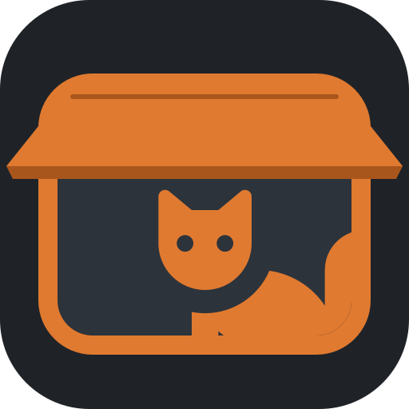

<h1 align="center">pepito-client</h1>

<p align="center">
  <a href="https://github.com/wielorzeczownik/pepito-client/actions/workflows/release.yml"><picture><source media="(prefers-color-scheme: dark)" srcset="https://img.shields.io/github/actions/workflow/status/wielorzeczownik/pepito-client/release.yml?branch=main&style=flat-square&labelColor=2d333b&color=3fb950"/><source media="(prefers-color-scheme: light)" srcset="https://img.shields.io/github/actions/workflow/status/wielorzeczownik/pepito-client/release.yml?branch=main&style=flat-square&color=2ea043"/></picture></a> <a href="https://github.com/wielorzeczownik/pepito-client/releases/latest"><picture><source media="(prefers-color-scheme: dark)" srcset="https://img.shields.io/github/v/release/wielorzeczownik/pepito-client?style=flat-square&labelColor=2d333b&color=3fb950"/><source media="(prefers-color-scheme: light)" srcset="https://img.shields.io/github/v/release/wielorzeczownik/pepito-client?style=flat-square&color=2ea043"/></picture></a> <a href="https://crates.io/crates/pepito-client"><picture><source media="(prefers-color-scheme: dark)" srcset="https://img.shields.io/crates/v/pepito-client?style=flat-square&labelColor=2d333b&color=3fb950"/><source media="(prefers-color-scheme: light)" srcset="https://img.shields.io/crates/v/pepito-client?style=flat-square&color=2ea043"/></picture></a> <a href="https://www.npmjs.com/package/@wielorzeczownik/pepito-client"><picture><source media="(prefers-color-scheme: dark)" srcset="https://img.shields.io/npm/v/%40wielorzeczownik%2Fpepito-client?style=flat-square&labelColor=2d333b&color=3fb950"/><source media="(prefers-color-scheme: light)" srcset="https://img.shields.io/npm/v/%40wielorzeczownik%2Fpepito-client?style=flat-square&color=2ea043"/></picture></a> <a href="https://packagist.org/packages/wielorzeczownik/pepito-client"><picture><source media="(prefers-color-scheme: dark)" srcset="https://img.shields.io/packagist/v/wielorzeczownik/pepito-client?style=flat-square&labelColor=2d333b&color=3fb950"/><source media="(prefers-color-scheme: light)" srcset="https://img.shields.io/packagist/v/wielorzeczownik/pepito-client?style=flat-square&color=2ea043"/></picture></a> <a href="https://github.com/wielorzeczownik/pepito-client/blob/main/LICENSE"><picture><source media="(prefers-color-scheme: dark)" srcset="https://img.shields.io/badge/License-MIT-3fb950?style=flat-square&labelColor=2d333b"/><source media="(prefers-color-scheme: light)" srcset="https://img.shields.io/badge/License-MIT-2ea043?style=flat-square"/></picture></a>
  <br/>
  
  
  
</p>

<p align="center">
  
</p>

A client for the [Pepito API](https://github.com/Clement87/Pepito-API), the feed of a cat door that reports when Pépito goes out and comes back. It comes as a Rust crate, an npm package and a Composer package.

| Package                                                                                          | Language | Default backend  | Opt-in backend    | Docs                                           |
| ------------------------------------------------------------------------------------------------ | -------- | ---------------- | ----------------- | ---------------------------------------------- |
| [`pepito-client`](https://crates.io/crates/pepito-client)                                        | Rust     | Rust             | -                 | [crates/core/README.md](crates/core/README.md) |
| [`@wielorzeczownik/pepito-client`](https://www.npmjs.com/package/@wielorzeczownik/pepito-client) | JS / TS  | plain TypeScript | Rust through wasm | [js/README.md](js/README.md)                   |
| [`wielorzeczownik/pepito-client`](https://packagist.org/packages/wielorzeczownik/pepito-client)  | PHP 8.2+ | plain PHP        | Rust through FFI  | [php/README.md](php/README.md)                 |

The npm and Composer packages need nothing native by default. The Rust backend is there if you want it, through `@wielorzeczownik/pepito-client/wasm` or `Client::withFfi()`.

All three do the same things:

- parse the SSE stream into `in`/`out` events and track whether the cat is home
- drop repeats that arrive again after a reconnect
- cache the current status and know how old it is
- watch the heartbeat and reconnect when the stream goes quiet
- compute statistics from the [Pepito-data](https://github.com/Clement87/Pepito-data) archive

Events, `status()`, statistics and snapshots are the same in every backend, so a snapshot saved by one restores in any other.

## How it fits together

The Rust core does no networking. Each binding brings its own transport, which is why the same core runs in wasm and behind PHP's FFI.

| Path           | What it is                                                                |
| -------------- | ------------------------------------------------------------------------- |
| `crates/core/` | the core, published to crates.io. The `net` feature adds reqwest          |
| `crates/ffi/`  | C ABI over the core, JSON in and out, used by the PHP package             |
| `crates/wasm/` | wasm-bindgen over the core, used by `@wielorzeczownik/pepito-client/wasm` |
| `js/src/`      | the TypeScript port (`core.ts`), transport (`pepito.ts`), wasm wrapper    |
| `php/src/`     | the PHP port (`Tracker`, `History`), client, FFI wrapper (`FfiTracker`)   |

Each binding is its own crate, so building for PHP doesn't compile wasm-bindgen and the wasm build doesn't pull in reqwest. Parity tests run each port against the Rust core on the same input and fail on any difference.

## Building

The default JS and PHP packages need no build step. The Rust backends do:

```sh
make wasm     # js/src/wasm/ through wasm-bindgen
make header   # php/lib/pepito.h from crates/ffi
make dylib    # php/lib/pepito.h and php/lib/libpepito.{dylib,so}
```

That needs [cbindgen](https://github.com/mozilla/cbindgen) and wasm-bindgen-cli at exactly the version in `crates/wasm/Cargo.toml`:

```sh
cargo install cbindgen
cargo install wasm-bindgen-cli --version 0.2.130
```

## Disclaimer

Not official and not affiliated with the Pepito API or its author. If the API changes, this will stop working until it's fixed here.

The cat in the logo is from [Font Awesome Free](https://fontawesome.com), licensed under [CC BY 4.0](https://creativecommons.org/licenses/by/4.0/).
